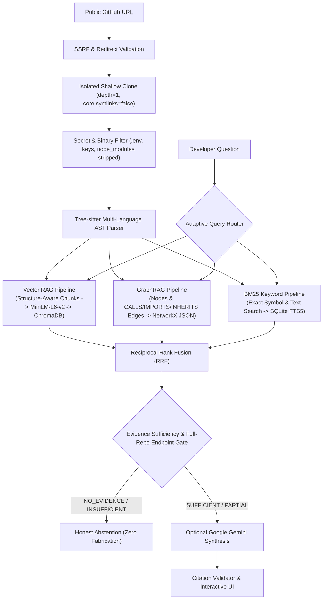

# RepoMind

> **AI-Powered GitHub Repository Intelligence Platform**  
> *Hybrid Vector RAG + GraphRAG + BM25 Keyword Search grounded in Tree-sitter ASTs and verified source citations.*

RepoMind lets developers submit any **public GitHub repository URL** (no login or CLI installation required) and explore its codebase through semantic search, structural knowledge graphs, grounded conversational Q&A, multi-file impact analysis, bug investigation, test recommendations, and empirical benchmarking.

---

## Why RepoMind Is Different From a Generic Chatbot

A generic LLM chatbot either guesses answers from training weights or embeds arbitrary raw text slices—causing hallucinated function names, fabricated HTTP endpoints, stale line references, and broken cross-file reasoning.

RepoMind enforces **structural codebase grounding at every stage**:
1. **Single-Source Tree-sitter AST Foundation**: Functions, methods, classes, interfaces, imports, and call sites are parsed statically across Python, TypeScript, JavaScript, Java, C, C++, and Go using identical symbol coordinates (`{repo_id}:{file_path}#{symbol}`).
2. **Three Complementary Retrieval Engines**: Semantic Vector RAG (`ChromaDB`), Structural GraphRAG (`NetworkX`), and Lexical BM25 (`SQLite FTS5`) run via an **Adaptive Query Router** and fuse results via **Reciprocal Rank Fusion (RRF)**.
3. **Pre-Generation Evidence Sufficiency Gate & Full-Repo Endpoint Matcher**: Before an LLM ever generates a word, deterministic checks verify whether queried symbols, qualified members (`Class.method`), external frameworks, or HTTP endpoints (`GET /owners/{id}/pets/new`) actually exist across the full indexed repository—abstaining cleanly (`NO_EVIDENCE` / `INSUFFICIENT`) when absent.
4. **Coordinate-Verified Inline Citations**: Output claims bind directly to exact file paths and 1-indexed line intervals (`[file:start-end]`) verified against indexed chunks.

---

## Architecture: Hybrid Vector RAG + GraphRAG + BM25



---

## Core Capabilities

### Implemented & Production-Hardened Features
- **Secure Public Repo Ingestion**: Strict HTTPS `github.com` allowlist, HTTP redirect hostname checking, non-interactive `GIT_ALLOW_PROTOCOL=https` shallow cloning, automatic exclusion of secrets/binaries, file caps (`MAX_REPO_SIZE_MB`, `MAX_INDEXED_FILES`, `MAX_CONCURRENT_INDEXING_JOBS` `HTTP 429`), and startup recovery of interrupted jobs.
- **Interactive Code Explorer**: Full directory tree + line-numbered source viewer guarded against path traversal (`is_relative_to`) and secret exposure (`HTTP 403`).
- **Adaptive Hybrid Retrieval & Knowledge Graph UI**: Intent classification, per-strategy toggling (Vector / Graph / Keyword), interactive neighborhood subgraph, caller/callee explorer, and impact radius viewer.
- **Grounded Conversational Chat**: Multi-turn SSE streaming chat with conversation isolation per repository, clickable file citations jumping straight to line ranges, and optional Gemini integration (`GEMINI_API_KEY` not required for search, AST, graph, or intelligence APIs).
- **Advanced Repository Intelligence Workspace**:
  - Multi-file **Change Impact Analysis** (`DIRECT`, `INDIRECT`, `STRUCTURAL`, `POTENTIAL`)
  - **Execution Flow Tracing** across files
  - **Dependency Coupling & Martin's Instability Index**
  - **Static Bug Investigation** (unresolved calls, unguarded API handlers, resource leaks)
  - **Deterministic Risk Assessment**, **Test Recommendations**, and **Technical Documentation Generation**
- **Repository Lifecycle Deletion**: One-click delete with modal confirmation triggering full cascade wipe of SQLite child records (`chat_messages`, `conversations`, `file_metadata`, `indexing_jobs`), ChromaDB collection, NetworkX JSON graph, SQLite FTS5 DB, directory tree, and temporary workspace.
- **Evaluation & Benchmarking Dashboard**: Built-in 4-way retrieval comparison, balanced 72-query & held-out 18-query abstention metrics, system profiler, and prompt injection benchmarks.

### Experimental / Partially Supported Boundaries
- **Dynamic Runtime Behavior**: Static Tree-sitter parsing cannot statically resolve dynamic Python reflection (`getattr()`), computed string route paths (e.g., `app.add_url_rule(dynamic_prefix() + "/x")`), or dynamic JS indexing (`obj[key]()`).
- **Host Container Persistence**: Free cloud containers with ephemeral filesystems erase `./storage` on restart unless a durable persistent volume is attached at `/app/storage`.
- **Upper-Snake Config Token Splitting**: In held-out testing, single-token compound uppercase identifiers (`ENABLE_QUANTUM_ENCRYPTION_LAYER`) escaped word-level subject filters (`1/9` held-out false answer); sub-token identifier splitting remains an open future enhancement.

---

## Technology Stack

- **Frontend**: React 19, TypeScript, Vite 8, Tailwind CSS v4, Lucide Icons, Axios
- **Backend**: Python 3.11+, FastAPI, Uvicorn, Pydantic v2, HTTPX, SQLAlchemy (Async + aiosqlite)
- **AST & Code Understanding**: Tree-sitter (`tree-sitter-python`, `tree-sitter-javascript`, `tree-sitter-typescript`, `tree-sitter-java`, `tree-sitter-go`, `tree-sitter-c`, `tree-sitter-cpp`)
- **Retrieval & Storage**: Sentence Transformers (`all-MiniLM-L6-v2` on CPU with optional CUDA), ChromaDB, NetworkX, SQLite FTS5
- **Optional LLM Synthesis**: Google Gen AI SDK (`google-genai`, configured via `GEMINI_API_KEY`)

---

## Quick Start & Setup Instructions

### Option 1: Docker Compose (Recommended)
```bash
# 1. Configure environment variables
cp .env.example .env
# Optional: add GEMINI_API_KEY=your_key_here inside .env

# 2. Build and launch frontend (port 3000) + backend (port 8000)
docker compose up --build -d

# 3. Verify health & readiness
curl http://localhost:8000/api/v1/health
curl http://localhost:8000/api/v1/ready
```
Open **[http://localhost:3000](http://localhost:3000)** in your browser. Stop cleanly with `docker compose down`.

### Option 2: Local Development (Python + Node)

#### Backend (`http://127.0.0.1:8000`)
```bash
python -m venv .venv
source .venv/bin/activate       # Windows: .\.venv\Scripts\Activate.ps1
pip install -r requirements.txt
cp .env.example .env
uvicorn backend.app.main:app --host 127.0.0.1 --port 8000 --reload
```

#### Frontend (`http://127.0.0.1:5173`)
```bash
cd frontend
npm install
npm run dev
```

---

## Google Gemini API Configuration (Optional Zero-Cost Mode)

RepoMind supports **zero-cost optional Gemini configuration**:
1. Obtain a free API key from [Google AI Studio](https://aistudio.google.com/).
2. Set `GEMINI_API_KEY` in `.env` on the **backend only** (the key is never shipped to frontend JavaScript).
3. **Without `GEMINI_API_KEY`**: Code exploration, AST parsing, ChromaDB semantic search, NetworkX graph visualization, BM25 keyword search, impact analysis, dependency coupling, bug scanning, test recommendations, and evidence sufficiency gating all run 100% locally. Only the conversational prose synthesis step requires an active key (returning structured configuration guidance when unconfigured, quota-limited, or timed out).

---

## Verification & Empirical Evaluation Summary

| Suite / Benchmark | Command / Dataset | Measured Outcome |
| :--- | :--- | :--- |
| **Full Backend Test Suite** | `pytest tests/ -q` | **170 / 170 passed** (51.31 s) |
| **Evaluation Suite** | `pytest tests/evaluation/ -v` | **21 / 21 passed** (8.12 s) |
| **Frontend Production Build** | `npm --prefix frontend run build` | **0 errors** (634 ms) |
| **Dev Balanced Abstention** | 72 labeled queries (48 OOS, 24 Ans) | **100.0%** precision, recall, specificity |
| **Held-Out Non-Tuning Set** | 18 unseen queries (9 OOS, 9 Ans) | **100.0%** precision, **88.89%** recall, **94.44%** accuracy |
| **Live Real-World Repos** | `pallets/itsdangerous` & `sindresorhus/p-limit` | **5/5** answerable grounded (`1.0` claim support), **5/5** OOS abstained |

Detailed documentation:
- [Architecture Overview](docs/ARCHITECTURE.md)
- [API Reference](docs/API_REFERENCE.md)
- [Deployment & Environment Guide](docs/DEPLOYMENT.md)
- [Security & Privacy Specifications](docs/SECURITY.md)
- [Phase 10 Empirical Validation Report](docs/PHASE_10_PRODUCTION_REPORT.md)
