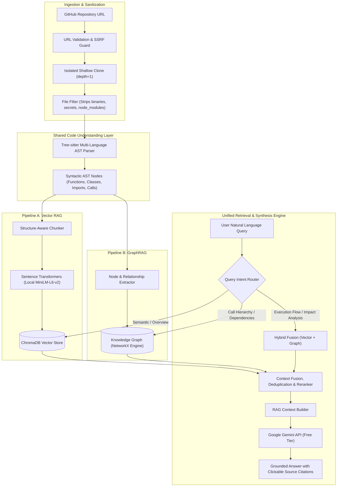

# System Architecture: Hybrid Vector RAG + GraphRAG

## Architecture Overview

RepoMind combines **Vector RAG** (semantic meaning of code, comments, documentation) and **GraphRAG** (structural relationships, function calls, inheritance, dependencies) through a shared Tree-sitter code understanding foundation.

---

## 1. Shared Code Understanding Layer

To prevent duplicated parsing logic and inconsistencies between vector chunks and graph nodes, Tree-sitter serves as the single source of truth:

- **Functions & Methods**: Name, parameters, return type, start/end line coordinates, parent class/module.
- **Classes & Interfaces**: Name, base classes, implemented interfaces, declared methods, line coordinates.
- **Imports & Dependencies**: Imported modules, symbols, relative/absolute targets.
- **Call Sites**: Statically identifiable call invocations (`obj.method()`, `func()`, `new Class()`).
- **Parent-Child Scopes**: Containing module, namespace, or class hierarchy.

### Symbol Identity & Content Fingerprinting Strategy

Symbol identifiers in RepoMind follow a deterministic, line-independent structure:
`{repository_id}:{file_path}#{parent_scope.}{symbol_name}` (with `::{disambiguation_idx}` for overloads).

- **Line-Shift Immunity**: Line numbers are intentionally treated as source-location metadata (`SymbolLocation.start_line`), not part of the symbol's unique ID. This ensures that inserting unrelated code or blank lines above a symbol does not invalidate graph edges or vector chunk caches.
- **Content Hash (`content_hash`)**: A 16-character SHA-256 fingerprint of normalized source code. This enables fast incremental re-indexing: an unchanged symbol preserves both its ID and its content hash.

### Call Extraction & Resolution Classification

Static call extraction distinguishes between confirmed syntax, inferred relationships, and unresolved dynamic dispatches:

- **CONFIRMED (Confidence 1.0)**: Direct calls to locally defined functions/classes in the same file, method calls on `self`/`this` matching local class methods, or calls matching explicitly imported module symbols.
- **INFERRED (Confidence 0.6 - 0.9)**: Static calls on typed/imported receivers (e.g., `math.sqrt`, `logger.info`, `user.calculate()`) or recognized standard library built-ins.
- **UNRESOLVED (Confidence 0.3)**: Dynamic dispatch, indirect invocations, reflection (`getattr()`), or higher-order callbacks where the runtime target cannot be statically guaranteed.
- **Constructor Calls**: Native detection of instantiation across languages (`new_expression` in JS/TS/C++, `object_creation_expression` in Java, class calls in Python).

### Known Static Analysis Limitations

1. **Dynamic Method Dispatch**: Python `getattr(obj, "method")()` and JavaScript `obj[methodName]()` cannot be resolved to a specific AST node statically.
2. **Untyped Duck Typing**: Calls on untyped Python parameters `param.execute()` or JavaScript arguments are mapped as `INFERRED` / `UNRESOLVED` rather than falsely confirmed.
3. **Macro Expansions in C/C++**: Complex preprocessor macro expansions that synthesize function definitions at compile-time are partially parsed as raw AST blocks.

---

## 2. Pipeline A: Vector RAG

Responsible for retrieving semantically relevant code snippets, comments, docstrings, and architectural summaries:
- **Chunker**: Logical structure-aware chunking preserving syntax integrity.
- **Embedding Model**: `sentence-transformers/all-MiniLM-L6-v2` (384-dimensional dense vectors generated locally).
- **Vector Database**: ChromaDB collections partitioned per repository.
- **Retrieval**: Dense cosine similarity + sparse BM25 keyword matching with Reciprocal Rank Fusion.

---

## 3. Pipeline B: GraphRAG

Responsible for modeling and traversing structural relationships and dependencies:
- **Graph Engine**: NetworkX with JSON/GraphML persistence in `storage/graphs/{repo_id}.json`.
- **Abstract Interface**: `BaseGraphStore` abstraction isolating graph storage, ensuring seamless future migration to Neo4j without modifying business logic.
- **Graph Nodes**:
  - `Repository`, `Directory`, `File`, `Module`, `Class`, `Interface`, `Function`, `Method`, `ApiEndpoint`, `DatabaseModel`.
- **Graph Relationships**:
  - `CONTAINS` (directory -> file, class -> method)
  - `IMPORTS` (file -> module)
  - `CALLS` (function -> function/method)
  - `INHERITS` (class -> base class)
  - `IMPLEMENTS` (class -> interface)
  - `DEFINES` (file -> symbol)
  - `DEPENDS_ON` (component -> component)

---

## 4. Unified Hybrid Retrieval & Context Fusion

The Query Router inspects incoming questions and directs them dynamically:

| Question Type | Example | Retrieval Strategy |
|---|---|---|
| Semantic / Conceptual | "Explain authentication in this project" | Vector RAG |
| Symbol / Call Graph | "Which functions call loginUser()?" | GraphRAG |
| Cross-cutting / Flow | "Explain the complete login execution flow" | Hybrid (Vector + Graph) |
| Change Impact | "What could be affected if I modify AuthService?" | Hybrid (Vector + Graph) |

The Context Builder synthesizes retrieved vector chunks alongside graph relationship summaries into a unified prompt context for Google Gemini, ensuring every fact is backed by clickable file and line citations.
