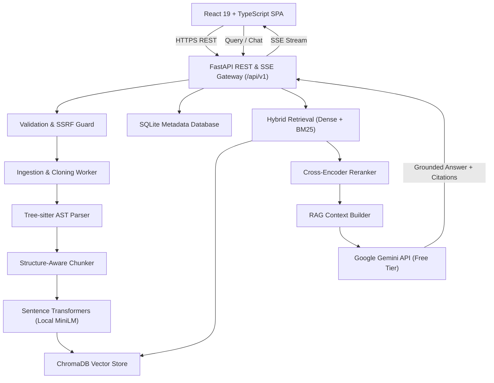

# System Architecture

## Architecture Overview

RepoMind is designed as a decoupled, micro-modular intelligence platform. The frontend single-page application (SPA) communicates over asynchronous HTTP REST and Server-Sent Events (SSE) with a FastAPI backend engine.

## Modular Responsibilities

1. **Frontend (`frontend/`)**: Modern responsive dark UI built with React 19, TypeScript, and Tailwind CSS v4. Delivers the Landing Page, URL Submission, Code Explorer, and Grounded Chat interface.
2. **API Backend (`backend/app/api/`)**: FastAPI routers managing validation, repository ingestion triggers, health monitoring, and chat sessions.
3. **Ingestion Engine (`backend/app/ingestion/`)**: Safe Git cloner into isolated temporary workspaces, language identification, and aggressive file filter (stripping binaries, secrets, `.git`, `node_modules`).
4. **Code Understanding (`backend/app/processing/`)**: Tree-sitter parsers extracting AST nodes (functions, classes, methods, imports) with exact line number ranges.
5. **Vector Store (`backend/app/vectorstore/`)**: ChromaDB persistent vector storage maintaining isolated collections per repository.
6. **Retrieval Engine (`backend/app/retrieval/`)**: Dense vector search combined with keyword retrieval (BM25) and reranking.
7. **RAG Synthesis (`backend/app/rag/`)**: Strict prompt orchestrators that feed extracted evidence into Google Gemini API and construct answers with mandatory clickable source citations.
8. **Metadata Storage (`backend/app/database/`)**: SQLite database tracking repository state, anonymous sessions, conversation history, and usage quotas.
