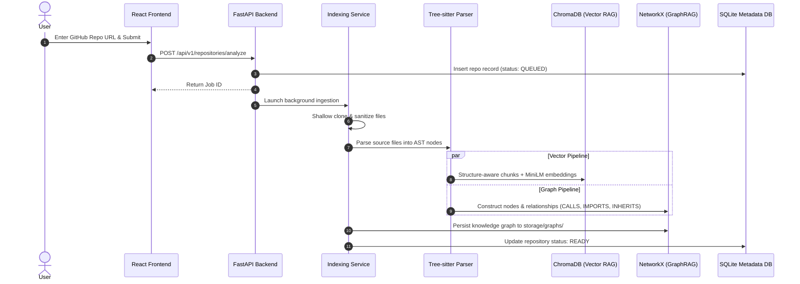
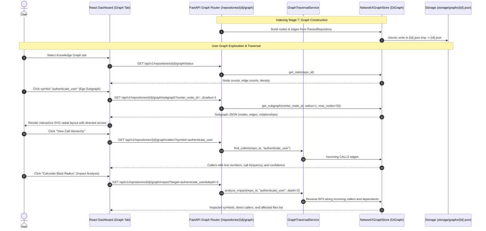
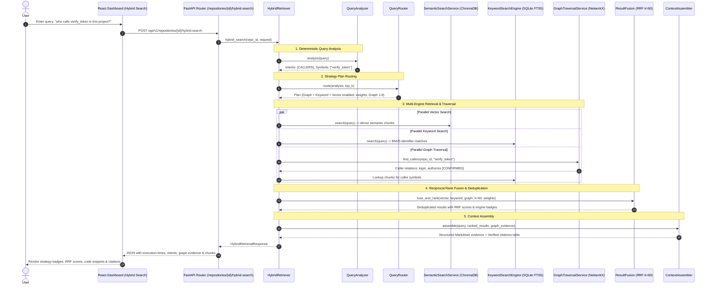
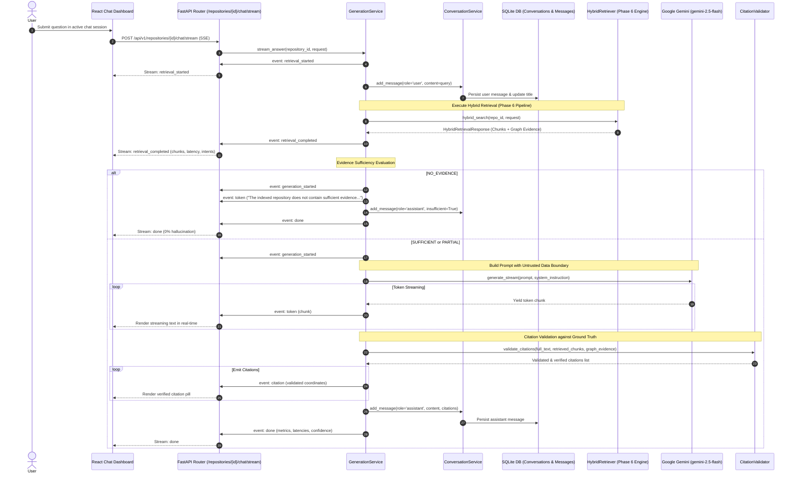
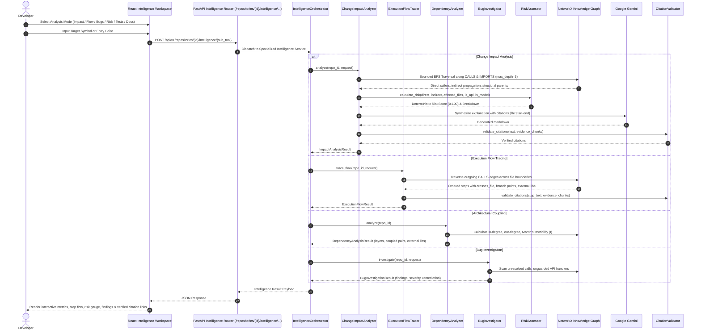

# Data Flow Specification: Hybrid Vector RAG + GraphRAG

## 1. Dual Ingestion & Indexing Flow



---

## 2. Hybrid Query & Grounded Answer Flow

```mermaid
sequenceDiagram
    autonumber
    actor User
    participant Frontend as React Frontend
    participant API as FastAPI Backend
    participant Router as Query Intent Router
    participant Chroma as ChromaDB Vector Store
    participant Graph as NetworkX Graph Store
    participant Builder as Context Builder
    participant Gemini as Google Gemini API

    User->>Frontend: Ask: "What happens when loginUser() is called?"
    Frontend->>API: POST /api/v1/chat/{repo_id}
    API->>Router: Classify query intent
    
    par Parallel Retrieval
        Router->>Chroma: Dense vector search for semantic concepts
        Chroma-->>Router: Top-K code chunks
    and Graph Traversal
        Router->>Graph: Traverse call chain & dependencies for loginUser()
        Graph-->>Router: Subgraph of callers, callees & imports
    end
    
    Router->>Builder: Merge vector snippets + graph relationship tree
    Builder->>Gemini: Stream prompt with strict citation constraints
    Gemini-->>API: Grounded response with verified line references
    API-->>Frontend: SSE Stream (Text + Clickable Citations)
    Frontend-->>User: Render syntax-highlighted answer with line links

---

## 3. Semantic Vector Search Flow (Phase 4 Completed)

```mermaid
sequenceDiagram
    autonumber
    actor User
    participant Frontend as React Dashboard (Search Tab)
    participant API as FastAPI Backend (/repositories/{id}/search)
    participant SearchService as SemanticSearchService
    participant Embedder as Local MiniLM-L6-v2 Embedder
    participant Chroma as ChromaDB Isolated Collection
    participant Explorer as Code Explorer (UI)

    User->>Frontend: Enter query: "JWT token verification" + optional filters
    Frontend->>API: POST /api/v1/repositories/{id}/search (query, top_k, filters)
    API->>SearchService: search(repo_id, query, top_k, language, file_path, symbol_type)
    SearchService->>Embedder: embed_text(query) -> 384-dim dense float vector
    SearchService->>Chroma: collection.query(query_embedding, where=filters, n_results=top_k)
    Chroma-->>SearchService: documents, metadatas, distances
    SearchService->>SearchService: Compute cosine similarity (1.0 - distance / 2.0)
    SearchService-->>API: List of SearchResult (ranked descending by similarity)
    API-->>Frontend: SearchResponse (JSON)
    Frontend-->>User: Render ranked chunk cards with % match and #L{start}-L{end}
    User->>Frontend: Click "Open in Code Explorer"
    Frontend->>Explorer: Switch to Explorer tab, select file, and highlight lines
```

---

## 4. Knowledge Graph Construction & Traversal Flow (Phase 5 Completed)



---

## 5. Hybrid Retrieval & Context Assembly Flow (Phase 6 Completed)



---

## 4. Phase 7: Conversational Grounded Query Flow & Streaming SSE



---

## 5. Phase 8: Advanced Repository Intelligence & Multi-File Change Impact Analysis Flow



