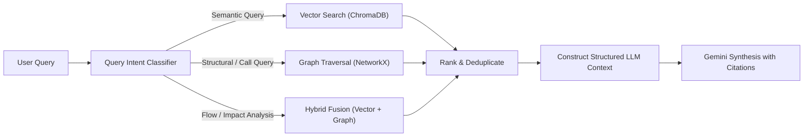

# Hybrid Retrieval-Augmented Generation (Hybrid RAG + GraphRAG)

## Objective

RepoMind combines **dense vector semantic search** with **graph-based structural traversal** to answer complex code queries that neither system could resolve in isolation.

---

## 1. Shared Code Ingestion & Parsing

Both pipelines consume identical AST outputs generated by Tree-sitter:

```
Source Code File
       ↓
Tree-sitter Parser
       ↓
Extracted Code Elements
(Functions, Classes, Imports, Call Sites, Line Numbers)
       ├──→ Vector Pipeline (Structure-Aware Chunker)
       └──→ Graph Pipeline (Node & Relationship Extractor)
```

- **Consistent Identifiers**: Symbol identifiers follow a deterministic scheme: `{repo_id}:{file_path}#{symbol_name}`.
- **Shared Line Mapping**: Line ranges (`start_line`, `end_line`) are identical in ChromaDB metadata and NetworkX node attributes.

---

## 2. Vector RAG Pipeline (Phase 4 Completed)

- **Target**: Semantic meaning, algorithms, documentation, configuration, and conceptual understanding.
- **Chunking Engine (`StructureAwareChunker`)**:
  - Structure-aware chunking prioritized by AST functions, methods, classes, and interfaces rather than arbitrary token boundaries.
  - Line coordinate preservation: 1-indexed start and end line coordinates preserved from Tree-sitter AST nodes.
  - Large Symbol Handling: Symbols exceeding 100 lines or 3000 characters are partitioned into overlapping sub-chunks (20 lines overlap) with part counters (`Part X of Y`) to maintain local context.
  - Documentation Fallback: Markdown and text files are partitioned by header hierarchy (`#`, `##`, `###`) into `DOC` chunks.
  - Configuration Manifest Fallback: Configs (`package.json`, `requirements.txt`, Dockerfiles, YAML/JSON) are partitioned using sliding windows into `CONFIG` chunks.
  - Context Headers: Every chunk is prepended with semantic file and scope coordinates:
    ```
    # File: backend/auth.py (Lines 10-25) [FUNCTION: verify_jwt]
    # Docstring: Validates JWT token signature.
    ```
- **Embeddings (`LocalSentenceTransformerService`)**:
  - Model: `sentence-transformers/all-MiniLM-L6-v2` (384-dimensional dense vectors).
  - Executed 100% locally on CPU with automatic CUDA GPU fallback detection (zero API cost).
  - Normalized embeddings for cosine similarity.
- **Index (`ChromaVectorStore`)**:
  - Persistent ChromaDB collections located at `storage/chroma/`.
  - Partitioned per repository using sanitized collection names (`repo_{sanitized_repo_id}`).
  - Metadata Schema (flattened primitives for ChromaDB compatibility):
    - `repository_id`: str
    - `file_path`: str
    - `symbol_id`: str
    - `symbol_name`: str
    - `symbol_type`: str (`FUNCTION`, `METHOD`, `CLASS`, `INTERFACE`, `DOC`, `CONFIG`)
    - `parent_symbol_id`: str
    - `language`: str
    - `start_line`: int
    - `end_line`: int
    - `content_hash`: str (SHA-256 fingerprint for incremental cache hits)
    - `part_index`: int
    - `total_parts`: int
- **Retrieval & Scoring**:
  - Distance metric: Cosine distance.
  - Similarity score mapping: $\text{similarity} = \max(0.0, \min(1.0, 1.0 - \frac{\text{distance}}{2.0}))$.
  - Metadata Filtering: Exact filtering on `language`, `file_path`, and `symbol_type`.
  - Incremental Indexing: Queries existing chunk hashes and skips embedding unchanged symbols.
  - Evaluated Performance: 100% Precision@1, 100% Recall@3, and 100% Citation Accuracy on ground-truth benchmark suite.

---

## 3. GraphRAG Pipeline

- **Target**: Structural connectivity, invocation chains, inheritance trees, module boundaries, and change impact.
- **Graph Engine**: NetworkX via `BaseGraphStore` interface.
- **Storage**: Serialized JSON knowledge graphs in `storage/graphs/{repo_id}.json`.
- **Relationship Extraction**:
  - `CONTAINS`: Structural containment (File defines Class, Class contains Method).
  - `IMPORTS`: Cross-file dependency tracking.
  - `CALLS`: Static invocation extraction (caller -> callee).
  - `INHERITS`: Subclassing hierarchy.
  - `IMPLEMENTS`: Interface realization.
- **Graph Traversal**:
  - In-degree traversal: Finding callers of a specific method.
  - Out-degree traversal: Tracing dependencies and callees.
  - Subgraph extraction: Ego graph (radius $k=1,2$) around a target symbol.

---

## 4. Query Intent Routing & Fusion

The Unified Hybrid Retriever assesses user queries to select the optimal retrieval mode:



### Context Construction Strategy
When both systems are engaged, the context builder structures evidence into:
1. **Structural Relationships (from GraphRAG)**:
   ```
   [Symbol Graph Evidence]
   - Method 'login' in backend/auth/service.py:15-42
     - Called by: 'handle_login' (backend/api/auth.py:8)
     - Calls: 'verify_password' (backend/auth/hasher.py:12), 'create_token' (backend/auth/jwt.py:30)
   ```
2. **Implementation Snippets (from Vector RAG)**:
   ```
   [Source Code Evidence]
   --- backend/auth/service.py (Lines 15-42) ---
   def login(credentials: LoginSchema) -> AuthToken:
       ...
   ```
3. **LLM Synthesis**: Gemini synthesizes the comprehensive answer citing exact files and line ranges.
