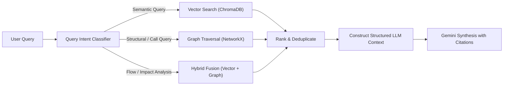

# Hybrid Retrieval-Augmented Generation (Hybrid RAG + GraphRAG)

## Objective

RepoMind combines **dense vector semantic search** with **graph-based structural traversal** to answer complex code queries that neither system could resolve in isolation.

---

## 1. Shared Code Ingestion & Parsing

Both pipelines consume identical AST outputs generated by Tree-sitter:

```
Source Code File
       ↓
Tree-sitter Parser
       ↓
Extracted Code Elements
(Functions, Classes, Imports, Call Sites, Line Numbers)
       ├──→ Vector Pipeline (Structure-Aware Chunker)
       └──→ Graph Pipeline (Node & Relationship Extractor)
```

- **Consistent Identifiers**: Symbol identifiers follow a deterministic scheme: `{repo_id}:{file_path}#{symbol_name}`.
- **Shared Line Mapping**: Line ranges (`start_line`, `end_line`) are identical in ChromaDB metadata and NetworkX node attributes.

---

## 2. Vector RAG Pipeline

- **Target**: Semantic meaning, algorithms, documentation, configuration, and conceptual understanding.
- **Chunking**: Structure-aware chunking prioritized by function and class definitions rather than arbitrary token boundaries.
- **Embeddings**: `sentence-transformers/all-MiniLM-L6-v2` executed locally on GPU/CPU (zero API cost).
- **Index**: Persistent ChromaDB collections (`storage/chroma/`).
- **Retrieval Strategy**: Dense cosine similarity fused with BM25 keyword matching via Reciprocal Rank Fusion (RRF).

---

## 3. GraphRAG Pipeline

- **Target**: Structural connectivity, invocation chains, inheritance trees, module boundaries, and change impact.
- **Graph Engine**: NetworkX via `BaseGraphStore` interface.
- **Storage**: Serialized JSON knowledge graphs in `storage/graphs/{repo_id}.json`.
- **Relationship Extraction**:
  - `CONTAINS`: Structural containment (File defines Class, Class contains Method).
  - `IMPORTS`: Cross-file dependency tracking.
  - `CALLS`: Static invocation extraction (caller -> callee).
  - `INHERITS`: Subclassing hierarchy.
  - `IMPLEMENTS`: Interface realization.
- **Graph Traversal**:
  - In-degree traversal: Finding callers of a specific method.
  - Out-degree traversal: Tracing dependencies and callees.
  - Subgraph extraction: Ego graph (radius $k=1,2$) around a target symbol.

---

## 4. Query Intent Routing & Fusion

The Unified Hybrid Retriever assesses user queries to select the optimal retrieval mode:



### Context Construction Strategy
When both systems are engaged, the context builder structures evidence into:
1. **Structural Relationships (from GraphRAG)**:
   ```
   [Symbol Graph Evidence]
   - Method 'login' in backend/auth/service.py:15-42
     - Called by: 'handle_login' (backend/api/auth.py:8)
     - Calls: 'verify_password' (backend/auth/hasher.py:12), 'create_token' (backend/auth/jwt.py:30)
   ```
2. **Implementation Snippets (from Vector RAG)**:
   ```
   [Source Code Evidence]
   --- backend/auth/service.py (Lines 15-42) ---
   def login(credentials: LoginSchema) -> AuthToken:
       ...
   ```
3. **LLM Synthesis**: Gemini synthesizes the comprehensive answer citing exact files and line ranges.
